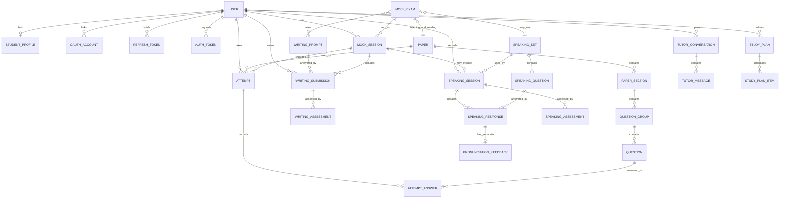
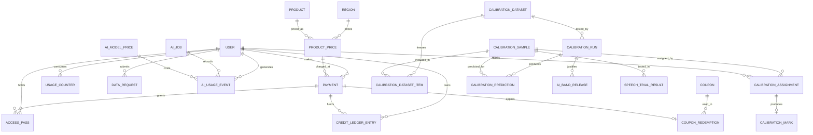

# IELTiva Database Design

**Status:** approved, with the owner's final Phase 0 decisions applied. **Database:** PostgreSQL 18 with Prisma 7.

Tables marked **(R2)** are created in Release 2. The rest are Release 1.

## Conventions

| Topic | Rule |
| --- | --- |
| Primary keys | UUIDv7, named `id` |
| Names | `snake_case` in the database, `camelCase` in Prisma through `@map` |
| Timestamps | `created_at`, and `updated_at` on mutable tables, in UTC (`timestamptz`) |
| Money | Integer minor units plus an ISO currency code, never floats |
| Band scores | `NUMERIC(2,1)` with a check for 0 to 9 in steps of 0.5 |
| Flexible content | JSONB only where the shape varies, validated with Zod in the API |
| Deletion | Foreign keys to personal data cascade or are cleared by the deletion job. Financial and audit records stay anonymised |

## Entity relationships

### Learning



`MOCK_EXAM` has separate foreign keys for its Listening and Reading papers and for its two Writing prompts. The diagram groups them for readability.

### Billing, AI and calibration



`MEDIA_ASSET` and `AUDIT_LOG` are referenced from many tables and left out for clarity.

## Enums

```text
Role               STUDENT, MARKER, EDITOR, ADMIN, SUPER_ADMIN
TestModule         ACADEMIC, GENERAL_TRAINING
Skill              LISTENING, READING, WRITING, SPEAKING
ContentStatus      DRAFT, IN_REVIEW, PUBLISHED, ARCHIVED
Provenance         ORIGINAL, LICENSED, AI_ASSISTED_REVIEWED
AttemptMode        PRACTICE, TIMED, MOCK
AttemptStatus      IN_PROGRESS, SUBMITTED, EXPIRED, ABANDONED
ProcessingStatus   PENDING, PROCESSING, COMPLETED, FAILED
WritingTaskType    ACADEMIC_TASK_1, GENERAL_TASK_1, TASK_2
SpeakingPart       PART_1, PART_2, PART_3
MockStage          LISTENING, READING, WRITING, SPEAKING, COMPLETED
ProductType        ASSESSMENT_PACK, PRACTICE_PASS, BUNDLE
PassStatus         ACTIVE, EXPIRED, REVOKED
LedgerReason       PURCHASE, RESERVE, CONSUME, RELEASE, EXPIRE, REFUND, ADMIN_GRANT
PaymentStatus      PENDING, PAID, FAILED, CANCELED, REFUNDED, PARTIALLY_REFUNDED
AiTier             DEFAULT, COMPLEX, LIGHT
BandVisibility     HIDDEN, INTERNAL, PUBLIC
SampleStatus       DRAFT, MARKING, ADJUDICATION, APPROVED, REJECTED, WITHDRAWN
SampleSplit        TUNING, VALIDATION, TEST
MarkKind           INDEPENDENT, ADJUDICATION
DataRequestType    EXPORT, DELETE
DataRequestStatus  PENDING, CANCELED, PROCESSING, COMPLETED, FAILED
MediaKind          LISTENING_AUDIO, EXAMINER_AUDIO, SPEAKING_RECORDING, IMAGE, DOCUMENT, DATA_EXPORT, CALIBRATION_AUDIO
QuestionType       MULTIPLE_CHOICE_SINGLE, MULTIPLE_CHOICE_MULTI, TRUE_FALSE_NOT_GIVEN,
                   YES_NO_NOT_GIVEN, MATCHING_GENERAL, MATCHING_HEADINGS, MATCHING_INFORMATION,
                   MATCHING_FEATURES, MATCHING_SENTENCE_ENDINGS, SENTENCE_COMPLETION,
                   SUMMARY_COMPLETION, NOTE_COMPLETION, TABLE_COMPLETION, FLOW_CHART_COMPLETION,
                   FORM_COMPLETION, DIAGRAM_LABELLING, PLAN_LABELLING, MAP_LABELLING, SHORT_ANSWER
```

Publish validation rejects `YES_NO_NOT_GIVEN` and `MATCHING_SENTENCE_ENDINGS` in General Training Reading, as the official format doesn't include them.

## Identity and regions

**users:** `id`, `email` (unique, lower-case), `password_hash` (null for Google-only accounts), `first_name`, `last_name`, `avatar_asset_id`, `role`, `country_code`, `locale`, `timezone`, `region_id`, `email_verified_at`, `is_suspended`, `last_login_at`, `deleted_at`, timestamps.

**student_profiles:** `user_id` (primary key), `test_module`, `target_band`, `exam_date`, `current_level_estimate`, `study_hours_per_week`, `notification_prefs` (JSONB), `onboarded_at`.

**oauth_accounts:** `id`, `user_id`, `provider`, `provider_account_id`. Unique on (`provider`, `provider_account_id`).

**refresh_tokens:** `id`, `user_id`, `family_id`, `token_hash` (unique), `expires_at`, `revoked_at`, `replaced_by_id`, `user_agent`, `ip_address`, `created_at`.

**auth_tokens:** `id`, `user_id`, `purpose` (`EMAIL_VERIFY`, `PASSWORD_RESET`), `token_hash` (unique), `expires_at`, `used_at`.

**regions:** `id`, `code` (unique, such as `BD`), `name`, `default_currency`, `default_locale`, `enabled_gateways` (text array), `tax_settings` (JSONB), `legal_settings` (JSONB), `is_active`, timestamps. One row with no country acts as the international default.

## Content

**media_assets:** `id`, `kind`, `bucket`, `object_key` (unique with bucket), `mime_type`, `size_bytes`, `duration_seconds`, `owner_user_id`, `upload_confirmed_at`, `delete_after`, `created_at`.

**papers:** `id`, `skill` (`LISTENING` or `READING`), `test_module` (null for Listening, which is shared), `title`, `slug` (unique), `difficulty`, `duration_seconds`, `status`, `provenance`, `source_note`, `is_premium`, `is_free_sample`, `band_table_version`, `version`, `parent_paper_id`, `created_by_id`, `reviewed_by_id`, `published_at`, timestamps.

**paper_sections:** `id`, `paper_id`, `position`, `title`, `instructions`, `passage_html` (Reading), `audio_asset_id` and `transcript` (Listening). Unique on (`paper_id`, `position`).

**question_groups:** `id`, `section_id`, `position`, `type`, `instructions`, `stimulus` (JSONB), `image_asset_id`.

**questions:** `id`, `group_id`, `number` (1 to 40 in the paper), `prompt`, `options` (JSONB), `answer_key` (JSONB), `explanation`, `tags` (text array).

```json
{ "accepted": ["library", "the library"], "caseSensitive": false, "maxWords": 2 }
```

**writing_prompts:** `id`, `task_type`, `title`, `prompt_text`, `image_asset_id`, `min_words`, `suggested_minutes`, `topic`, `sample_answer`, `status`, `provenance`, `source_note`, `is_premium`, `created_by_id`, `reviewed_by_id`, `published_at`, timestamps.

**speaking_sets (R2):** `id`, `title`, `topic`, `status`, `provenance`, `source_note`, `is_premium`, `created_by_id`, `reviewed_by_id`, `published_at`, timestamps.

**speaking_questions (R2):** `id`, `set_id`, `part`, `position`, `text`, `cue_card` (JSONB), `prep_seconds`, `max_answer_seconds`, `examiner_audio_asset_id`.

**Published content doesn't change.** Editing creates a new row with `parent_paper_id` and a higher `version`, so past attempts still show what the student saw. The author and reviewer must be different people.

## Attempts and writing

**attempts:** `id`, `user_id`, `paper_id`, `mock_session_id`, `mode`, `status`, `started_at`, `expires_at`, `submitted_at`, `raw_score`, `band_score`, `band_table_version`, `time_spent_seconds`, timestamps.

**attempt_answers:** `id`, `attempt_id`, `question_id`, `response` (JSONB), `is_correct`, `is_flagged`, `answered_at`. Unique on (`attempt_id`, `question_id`).

**writing_submissions:** `id`, `user_id`, `prompt_id`, `mock_session_id`, `parent_submission_id`, `text`, `word_count`, `time_spent_seconds`, `status`, `submitted_at`, timestamps.

**writing_assessments:** `id`, `submission_id`, `ai_job_id`, `task_response_band`, `coherence_cohesion_band`, `lexical_resource_band`, `grammar_band`, `overall_band`, `feedback` (JSONB), `task_name`, `provider`, `model_id`, `prompt_version`, `rubric_version`, `band_release_id` (null means no public release applied), `review_status`, `reviewer_id`, `reviewer_note`, `is_current`, `created_at`.

Band values are stored but returned only according to `band_release_id` and role. `task_response_band` holds Task Achievement for Task 1.

## Mock exams

**mock_exams:** `id`, `title`, `test_module`, `listening_paper_id`, `reading_paper_id`, `writing_task1_prompt_id`, `writing_task2_prompt_id`, `speaking_set_id` (null in Release 1), `status`, `is_premium`, timestamps.

**mock_sessions:** `id`, `user_id`, `mock_exam_id`, `stage`, `listening_band`, `reading_band`, `writing_band`, `speaking_band`, `overall_band` (null unless all four skills exist and are releasable), `started_at`, `completed_at`, timestamps.

## Speaking (R2)

**speaking_sessions:** `id`, `user_id`, `set_id`, `mock_session_id`, `status`, `started_at`, `completed_at`, timestamps.

**speaking_responses:** `id`, `session_id`, `question_id`, `audio_asset_id`, `duration_seconds`, `transcript`, `word_timings` (JSONB), `fluency_metrics` (JSONB), `status`. Unique on (`session_id`, `question_id`).

**pronunciation_feedback:** `id`, `response_id` (unique), `speech_provider`, `provider_version`, `language`, `measures` (JSONB), `feedback` (JSONB), `created_at`. Nothing reads this table when calculating a band.

**speaking_assessments:** `id`, `session_id`, `ai_job_id`, `fluency_coherence_band`, `lexical_resource_band`, `grammar_band`, `pronunciation_band` (stays null until a validated method exists), `complete_band` (stays null until all four criteria are validated), `criteria_covered`, `feedback` (JSONB), `task_name`, `provider`, `model_id`, `prompt_version`, `rubric_version`, `band_release_id`, `review_status`, `reviewer_id`, `reviewer_note`, `is_current`, `created_at`.

**speech_trial_results:** `id`, `sample_id`, `speech_provider`, `provider_version`, `language`, `transcript`, `transcript_accuracy`, `measures` (JSONB), `instructor_notes`, `created_at`. It supports the Azure trial and can be populated before the student feature exists, so it's created in Release 1.

## AI operations

**ai_task_routes:** `task` (primary key), `tier`, `provider_override`, `model_override`, `effort`, `is_enabled`, `updated_by_id`, `updated_at`. Defaults live in code, and a row overrides them.

**ai_jobs:** `id`, `user_id`, `task_name`, `status`, `subject_type`, `subject_id`, `attempts`, `error_code`, `error_message`, `queued_at`, `started_at`, `finished_at`.

**ai_usage_events:** `id`, `user_id`, `ai_job_id`, `calibration_run_id`, `task_name`, `tier`, `provider`, `model_id`, `input_tokens`, `output_tokens`, `cache_read_tokens`, `cache_write_tokens`, `is_batch`, `cost_microusd`, `price_id`, `latency_ms`, `outcome`, `created_at`. One row per provider call.

**ai_model_prices:** `id`, `provider`, `model_id`, `input_microusd_per_mtok`, `output_microusd_per_mtok`, `cache_read_microusd_per_mtok`, `cache_write_microusd_per_mtok`, `batch_multiplier`, `effective_from`, `effective_to`. Costs are stored at write time.

**tutor_conversations (R2):** `id`, `user_id`, `title`, `archived_at`, timestamps.

**tutor_messages (R2):** `id`, `conversation_id`, `sequence`, `role`, `content` (JSONB: raw content blocks), `model_id`, `created_at`. Unique on (`conversation_id`, `sequence`). Rows are never edited.

## Calibration and band release

**calibration_samples:** `id`, `reference_code` (unique), `skill`, `task_type`, `prompt_snapshot`, `writing_prompt_id`, `response_text`, `audio_asset_id`, `transcript`, `test_module`, `learner_level`, `first_language`, `region`, `accent_notes`, `is_adversarial`, `split`, `status`, `consent_version`, `consent_recorded_at`, `adult_or_guardian_consent`, `deidentified_at`, `provenance`, `created_by_id`, timestamps.

No names or contact details are stored here. The signed consent stays outside the application, or in a restricted document, linked by `reference_code`.

**calibration_assignments:** `id`, `sample_id`, `marker_id`, `kind`, `due_at`, `completed_at`. Unique on (`sample_id`, `marker_id`, `kind`).

**calibration_marks:** `id`, `assignment_id` (unique), `criterion_bands` (JSONB), `overall_band`, `rubric_version`, `notes`, `created_at`. Markers can't read each other's marks until their own is submitted, or the AI's result at any point.

**calibration_datasets:** `id`, `skill`, `version`, `status`, `frozen_at`, `approved_by_id`, `notes`. Unique on (`skill`, `version`). Frozen datasets don't change.

**calibration_dataset_items:** `dataset_id`, `sample_id` (composite primary key), `split`, `reference_bands` (JSONB, final human result).

**calibration_runs:** `id`, `dataset_id`, `split`, `task_name`, `provider`, `model_id`, `effort`, `prompt_version`, `rubric_version`, `status`, `metrics` (JSONB), `thresholds` (JSONB), `passed`, `created_by_id`, `started_at`, `finished_at`. Cost comes from `ai_usage_events`.

**calibration_predictions:** `id`, `run_id`, `sample_id`, `predicted_bands` (JSONB), `raw_output` (JSONB), `error_summary` (JSONB). Unique on (`run_id`, `sample_id`).

**ai_band_releases:** `id`, `skill`, `task_name`, `provider`, `model_id`, `prompt_version`, `rubric_version`, `visibility`, `calibration_run_id` (required for `PUBLIC`), `instructor_signoff_by`, `owner_signoff_by`, `opened_at`, `closed_at`, `closed_reason`. A partial unique index allows one open release per (`skill`, `task_name`).

A database check rejects `PUBLIC` without a calibration run and both sign-offs, and formal runs need samples marked by two independent markers. The API also verifies that the run passed on the test split.

## Billing

**products:** `id`, `code` (unique), `type`, `name`, `description`, `grants` (JSONB: credits by feature, pass days, flags), `is_active`, `position`, timestamps.

**product_prices:** `id`, `product_id`, `region_id`, `currency`, `amount_minor`, `is_active`, timestamps.

**payments:** `id`, `user_id`, `product_price_id`, `coupon_id`, `gateway`, `gateway_transaction_id`, `gateway_validation_id`, `tracking_id` (unique), `amount_minor`, `discount_minor`, `currency`, `product_snapshot` (JSONB), `status`, `raw_response` (JSONB), `paid_at`, timestamps. Unique on (`gateway`, `gateway_transaction_id`).

**payment_events:** `id`, `gateway`, `event_key`, `payload` (JSONB), `processed_at`, `created_at`. Unique on (`gateway`, `event_key`).

**access_passes:** `id`, `user_id`, `product_id`, `payment_id`, `status`, `starts_at`, `ends_at`, `granted_by_id`, timestamps. A renewal starts when the current pass ends, so early purchase loses no days.

**credit_ledger_entries:** `id`, `user_id`, `feature`, `delta`, `reason`, `payment_id`, `subject_type`, `subject_id`, `expires_at`, `idempotency_key` (unique), `created_at`. Insert-only. The balance is the sum of entries, and the row lock on the user keeps concurrent spending safe.

**usage_counters:** `user_id`, `feature`, `period_start` (composite primary key), `used`, `updated_at`. For free allowances.

**coupons:** `id`, `code` (unique), `discount_type`, `discount_value`, `currency`, `max_redemptions`, `per_user_limit`, `starts_at`, `ends_at`, `is_active`.

**coupon_redemptions:** `id`, `coupon_id`, `user_id`, `payment_id` (unique), `created_at`.

## Privacy, administration and CMS

**retention_policies:** `data_type` (primary key), `retain_days` (null means keep), `action` (`DELETE`, `ANONYMISE`), `is_enabled`, `updated_by_id`, `updated_at`.

**data_requests:** `id`, `user_id`, `type`, `status`, `requested_at`, `cancel_until`, `processed_at`, `export_asset_id`, `failure_reason`, `processed_by_id`. A completed deletion keeps this row without personal details, as evidence.

**audit_logs:** `id`, `actor_id`, `action`, `entity_type`, `entity_id`, `before` (JSONB), `after` (JSONB), `ip_address`, `created_at`. Insert-only.

**notifications:** `id`, `user_id`, `type`, `title`, `body`, `link`, `read_at`, `created_at`.

**blog_posts:** `id`, `slug` (unique), `locale`, `title`, `excerpt`, `body_html`, `cover_asset_id`, `author_id`, `seo_title`, `seo_description`, `status`, `published_at`, timestamps.

**faqs:** `id`, `locale`, `question`, `answer`, `category`, `position`, `is_published`.

**contact_messages:** `id`, `name`, `email`, `subject`, `message`, `handled_at`, `created_at`.

## Analytics and planner

**daily_activity:** `user_id`, `activity_date` (composite primary key), `minutes_studied`, `questions_answered`, `questions_correct`, `writing_count`, `speaking_count`.

**question_type_stats (R2):** `user_id`, `skill`, `question_type` (composite primary key), `attempted`, `correct`, `updated_at`.

**study_plans (R2):** `id`, `user_id`, `ai_job_id`, `target_band`, `exam_date`, `starts_on`, `ends_on`, `summary`, `is_active`, timestamps.

**study_plan_items (R2):** `id`, `plan_id`, `scheduled_date`, `skill`, `title`, `description`, `estimated_minutes`, `linked_type`, `linked_id`, `completed_at`.

## Key indexes and constraints

| Table | Index or constraint | Purpose |
| --- | --- | --- |
| `attempts` | (`user_id`, `created_at` DESC) | History |
| `attempts` | Partial unique (`user_id`, `paper_id`) where `status = 'IN_PROGRESS'` | One active attempt per paper |
| `papers` | (`skill`, `status`, `test_module`) | Library filters |
| `writing_submissions` | (`user_id`, `created_at` DESC) | History |
| `writing_assessments` | Partial unique `submission_id` where `is_current` | One current assessment |
| `speaking_assessments` | Partial unique `session_id` where `is_current` | One current assessment |
| `ai_jobs` | (`status`, `queued_at`) | Monitoring |
| `ai_usage_events` | (`created_at`), (`task_name`, `created_at`), (`user_id`, `created_at`) | Cost reports |
| `ai_band_releases` | Partial unique (`skill`, `task_name`) where `closed_at IS NULL` | One open release |
| `access_passes` | (`user_id`, `status`, `ends_at`) | Entitlement checks |
| `credit_ledger_entries` | (`user_id`, `feature`, `created_at`) | Balance |
| `product_prices` | Partial unique (`product_id`, `region_id`, `currency`) where `is_active` | One live price |
| `calibration_assignments` | (`marker_id`, `completed_at`) | Marking queue |
| `data_requests` | (`status`, `cancel_until`) | Processing |
| `media_assets` | (`delete_after`) | Retention job |
| `study_plans` | Partial unique `user_id` where `is_active` | One active plan |

Partial unique indexes and check constraints go in hand-edited SQL migrations, because Prisma's schema doesn't express them.

## Scoring reference data

Conversion tables live in `packages/shared/src/scoring`, versioned, with the version recorded on papers and attempts.

**Official information:** IELTS publishes only these average points and says exact marks vary by test version ([source](https://ielts.org/take-a-test/your-results/ielts-scoring-in-detail)):

| Band | Listening | Academic Reading | General Training Reading |
| --- | --- | --- | --- |
| 8 | 35 | 35 | Not published |
| 7 | 30 | 30 | 35 |
| 6 | 23 | 23 | 30 |
| 5 | 16 | 15 | 23 |
| 4 | Not published | Not published | 15 |

**Working table:** the commonly circulated table below matches those points, but its other values are **not official**. The instructor must approve it before use, and results are labelled as estimates.

| Band | Listening | Academic Reading | General Training Reading |
| --- | --- | --- | --- |
| 9 | 39-40 | 39-40 | 40 |
| 8.5 | 37-38 | 37-38 | 39 |
| 8 | 35-36 | 35-36 | 37-38 |
| 7.5 | 32-34 | 33-34 | 36 |
| 7 | 30-31 | 30-32 | 34-35 |
| 6.5 | 26-29 | 27-29 | 32-33 |
| 6 | 23-25 | 23-26 | 30-31 |
| 5.5 | 18-22 | 19-22 | 27-29 |
| 5 | 16-17 | 15-18 | 23-26 |
| 4.5 | 13-15 | 13-14 | 19-22 |
| 4 | 10-12 | 10-12 | 15-18 |

**Overall band (official):** the mean of four skills, rounded to the nearest half band, with .25 rounding up to .5 and .75 up to the next whole band. Official examples: 6.25 becomes 6.5, 3.875 becomes 4.0, and 6.125 becomes 6.0. Calculate with integers to avoid floating-point errors.

## Retention

Seed values for `retention_policies`, adjustable by admins. Confirm them against the law in each market.

| Data type | Starting value | Action |
| --- | --- | --- |
| Speaking recordings | 90 days | Delete, transcripts and reports stay |
| Expired authentication tokens | 7 days after expiry | Delete |
| Data exports | 7 days | Delete |
| Contact messages | 365 days | Delete |
| AI job errors | 180 days | Clear details |
| Inactive accounts | Off | Decide per market |
| Payments | Per accounting law | Anonymise, never delete early |
| Calibration samples | Until consent ends or dataset retires | Delete where consent is withdrawn before freezing |

Backups are daily and kept for 30 days, with a tested restore.
