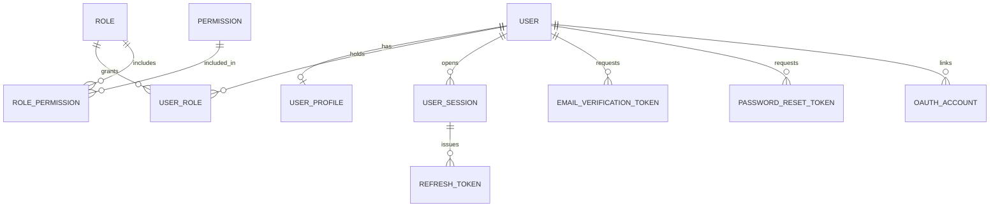
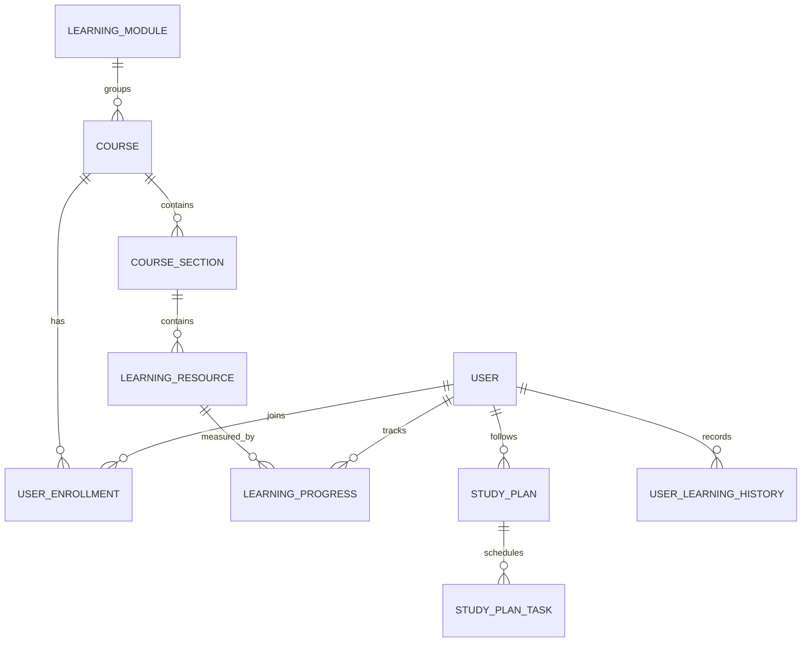
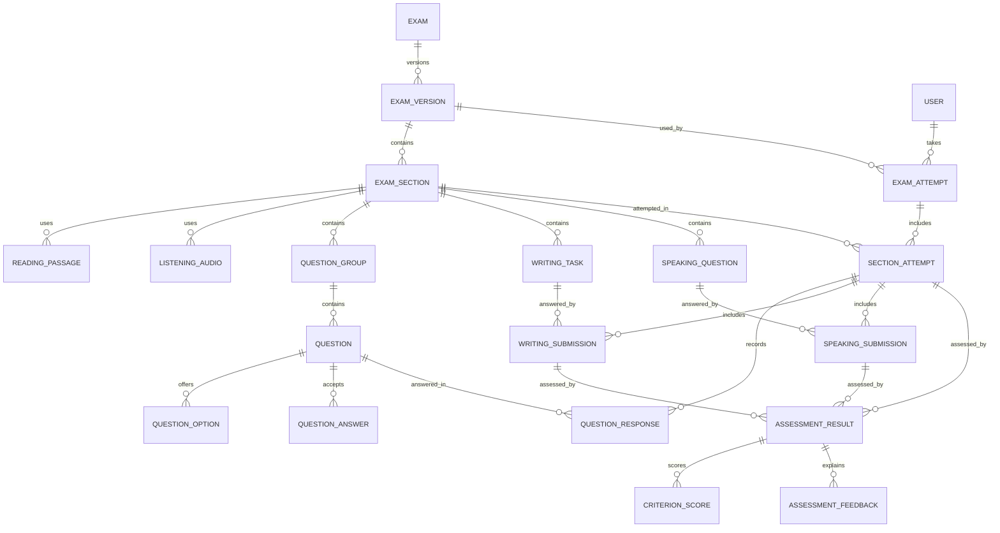
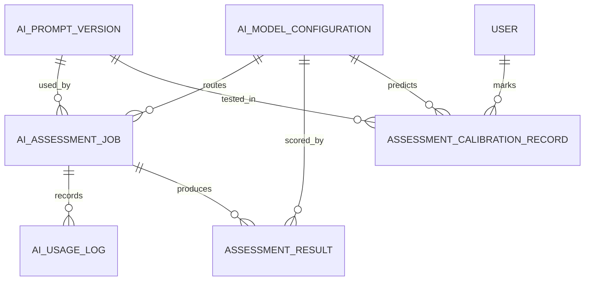
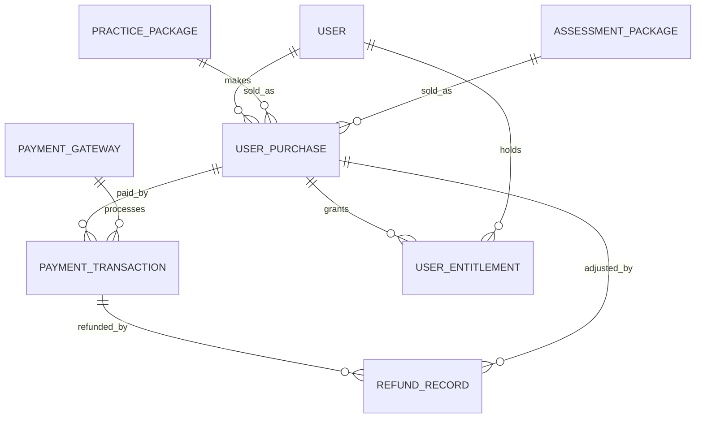

# IELTiva Database Design

**Status:** implemented in Phase 2A and reviewed in Phase 2D. **Database:** PostgreSQL 18 with Prisma 7.

## Current state

Phase 2A implemented this design in `apps/api/prisma/schema.prisma`, with 57 models: the 56 approved entities plus the `app_metadata` foundation table. Phase 3 uses the user, learning, notification, audit and settings tables, and added columns to them. Exam, attempt, AI and payment tables await later phases.

**Phase 3 additions (additive migration `20261104090000_phase_3_core_platform`):**

| Table | Added |
| --- | --- |
| `learning_modules` | `exam_type`, `difficulty`, `estimated_minutes`, `status`, `published_at` |
| `courses` | `thumbnail_url`, `difficulty`, `learning_objectives`, `estimated_minutes`, `instructor_id` |
| `course_sections` | `is_visible`, `archived_at` |
| `learning_resources` | `external_url`. `ResourceType` gained `EXTERNAL_LINK`, `VOCABULARY`, `GRAMMAR`, `PRACTICE_GUIDANCE` |
| `user_enrollments` | `last_accessed_at`, `last_resource_id` |
| `learning_progress` | `last_accessed_at`, and a check that completed means 100% |
| `user_profiles` | `daily_goal_minutes`, `preferred_skills`, `notification_prefs` |
| `email_verification_tokens` | `new_email`, for confirmed email changes |
| `notifications` | `audience`, `audience_role`, `status`, `published_at`, `expires_at`, `created_by_id`, `dedupe_key`. `NotificationType` gained `SECURITY`, `ANNOUNCEMENT` |
| `user_notifications` | `dismissed_at` |
| `content_publication_history` | `module_id`. `PublicationAction` gained `CONTENT_UPDATED` |
| `audit_logs` | A trigger that rejects edits and deletion |

## Conventions

| Topic | Rule |
| --- | --- |
| Primary keys | UUIDv7 stored as `uuid`, except composite join keys and natural keys such as `platform_settings.key` |
| Names | `snake_case` tables and columns, `camelCase` in Prisma through `@map` |
| Timestamps | `timestamptz(3)` in UTC. Calendar dates such as `exam_date` use `date` |
| Money | Integer minor units plus a three-letter currency code. AI costs use `bigint` micro-USD |
| Band scores | `numeric(2,1)` with a check for 0 to 9 in half-band steps |
| JSON | Only for varying shapes: question stimulus and responses, feedback evidence, AI parameters, gateway payloads, snapshots, and settings |
| Soft deletion | `deleted_at` on `users`, `courses`, `learning_resources`, `exams` and both package tables |
| Provider data | Model names and prices live in database rows, never in application logic |

## A. User management

| Entity | Purpose |
| --- | --- |
| `User` | Account, with a unique lower-case email. `password_hash` is null for Google-only accounts. Status and deletion dates support deletion requests |
| `UserProfile` | One-to-one personal and study details, including locale, timezone and country |
| `Role`, `Permission` | Catalogues identified by a unique `code` |
| `UserRole`, `RolePermission` | Many-to-many joins with composite keys |
| `UserSession` | A signed-in device |
| `RefreshToken` | Hashed token linked to a session, with `family_id` and `replaced_by_id` for rotation and reuse detection |
| `EmailVerificationToken`, `PasswordResetToken` | Hashed, expiring, single-use tokens |
| `OAuthAccount` | External identity, unique per provider account and per user and provider |

Roles are `STUDENT`, `INSTRUCTOR` (reserved), `MARKER`, `EDITOR`, `ADMIN` and `SUPER_ADMIN`. Only hashes of tokens are stored. Phase 2B added `failed_login_attempts`, `locked_until` and `terms_accepted_at` to `users`.

## B. Learning system

| Entity | Purpose |
| --- | --- |
| `LearningModule` | Top-level area, seeded with the four skills |
| `Course`, `CourseSection`, `LearningResource` | Structured content. A null `exam_type` means both Academic and General Training |
| `UserEnrollment` | One per user and course |
| `LearningProgress` | One per user and resource |
| `StudyPlan`, `StudyPlanTask` | One active plan per user, with dated tasks |
| `UserLearningHistory` | Event log for activity and analytics |

## C and D. Examination content and attempts

`Exam` is the stable identity. `ExamVersion` holds the content, and **attempts point to a version, never to an exam**.

| Entity | Purpose |
| --- | --- |
| `Exam`, `ExamVersion` | Identity and numbered versions. Exam content is created inside a version, and a new version is a new row |
| `ExamSection` | Timed part of a version, for one skill |
| `ReadingPassage`, `ListeningAudio` | Section material. Audio stores a private storage key |
| `QuestionGroup`, `Question`, `QuestionOption`, `QuestionAnswer` | Questions of every official type. Accepted answers are separate rows |
| `WritingTask` | Academic Task 1, General Training Task 1 or Task 2 |
| `SpeakingQuestion` | Parts 1, 2 and 3 |
| `ExamAttempt`, `SectionAttempt` | Timed session state, with server expiry and last-saved times for resuming |
| `QuestionResponse` | One row per section attempt and question, so autosave is an upsert |
| `WritingSubmission`, `SpeakingSubmission` | Student work. Rewrites link to the original, and pronunciation data stays in its own field |
| `AssessmentResult` | One assessment of exactly one subject, with one current result per subject |
| `CriterionScore`, `AssessmentFeedback` | Band per criterion, and ordered feedback |

### Published content protection

Database triggers enforce this, so application bugs and manual SQL can't bypass it:

- After publication, a version and all its sections, material, questions, options, answers, tasks and speaking questions can't be inserted, updated or deleted.
- The only allowed change to a published version is archiving it.
- Attempts can begin only on a version with `PUBLISHED` status.
- Foreign keys from attempts and responses to content use `RESTRICT`.
- Each exam has at most one published version, and each student at most one in-progress attempt per version.

## E. AI assessment infrastructure

| Entity | Purpose |
| --- | --- |
| `AIModelConfiguration` | Provider, model, tier, effort, parameters, prices and band visibility per task. One active row per task and tier |
| `AIPromptVersion` | Numbered prompt and rubric versions, one active per task |
| `AIAssessmentJob` | Job state, with a unique idempotency key |
| `AIUsageLog` | One row per provider call, with tokens, calculated cost, latency and outcome. Provider and model are stored as text, so history survives configuration changes |
| `AssessmentCalibrationRecord` | One human mark, adjudication or AI prediction for a de-identified sample in a dataset version and split |

**Band gate:** `band_visibility` defaults to `HIDDEN`. A check constraint rejects `PUBLIC` unless `calibration_validated_at` and both instructor and owner approvals are recorded. Each `AssessmentResult` keeps its own visibility and model snapshot.

**Calibration:** one marker can record one mark per sample and dataset, which supports independent double marking. Each model and prompt combination can record one prediction per sample and dataset.

**Speaking:** a `PRONUNCIATION` criterion exists for possible future use, but pronunciation feedback is stored separately and no complete band is allowed until all four criteria are validated. This rule belongs to the application layer in Release 2.

## F. Payments and packages

| Entity | Purpose |
| --- | --- |
| `PracticePackage` | Time-limited pass, priced per region and currency |
| `AssessmentPackage` | Credit pack for one skill, priced per region and currency |
| `PaymentGateway` | Provider catalogue with regions and currencies. Secrets stay in the environment |
| `UserPurchase` | An order for exactly one package, with price and package copied at purchase |
| `PaymentTransaction` | A gateway attempt, unique on tracking ID, idempotency key, and gateway plus gateway transaction ID |
| `UserEntitlement` | Pass dates or credits granted, used and reserved. A check prevents overspending |
| `RefundRecord` | A refund against a transaction |

Financial records use `RESTRICT`, so they can't be deleted with a user. User accounts with purchases are anonymised rather than removed. There are no subscription tables.

## G. Platform administration

| Entity | Purpose |
| --- | --- |
| `AuditLog` | Who changed what, with before and after values |
| `Notification`, `UserNotification` | A message, and each recipient's read state |
| `PlatformSetting` | Keyed JSON configuration, including retention periods and regional defaults |
| `ContentPublicationHistory` | Publication actions on exam versions and courses |

## Indexing strategy

- Every foreign key has an index, or leads a unique index. Phase 2D verified this with a catalog query and added the missing ones.
- History screens use `(user_id, created_at DESC)` style indexes.
- Worker scans use status plus time, such as `(status, queued_at)` and `(status, expires_at)`.
- Cost reports use `created_at`, `(task_key, created_at)` and `(user_id, created_at)` on `ai_usage_logs`.
- Cleanup jobs use expiry columns on tokens, sessions and recordings.

### Rules added by hand

Prisma's schema can't express these, so they're SQL in the Phase 2A migration. A later `prisma migrate dev` won't remove them, and a test confirms that no schema difference remains.

| Type | Rule |
| --- | --- |
| Partial unique index | One in-progress attempt, published version, active study plan, active AI configuration per task and tier, active prompt per task, and current assessment per subject |
| Partial unique index | One calibration mark per marker, and one prediction per model and prompt, per sample and dataset |
| Check | Lower-case emails, valid bands, non-negative money, exactly one package per purchase, exactly one subject per assessment, credit limits, and the band gate |
| Trigger | Published content protection and published-only attempts |

## Seed data

`npm run db:seed` is repeatable. It creates 6 roles, 29 permissions and their mappings, 5 learning modules, 7 platform settings including its mapping version, 1 disabled SSLCommerz gateway, and up to 3 inactive AI configurations from `AI_PROVIDER` and the `AI_MODEL_*` variables, with bands hidden. Later edits to settings, gateways and AI rows are kept. Default role mappings apply once per version, so a repeat seed can't undo an administrator's change. **It creates no user accounts and no package prices.** `npm run admin:create` creates or promotes the first administrator from `ADMIN_EMAIL` and `ADMIN_PASSWORD`.

## Differences from the Phase 0 design

The approved Phase 2A entity list replaces parts of the earlier design:

| Earlier table | Now |
| --- | --- |
| `ai_band_releases` | Band visibility and approvals on `AIModelConfiguration` |
| Calibration samples, assignments, marks, datasets, runs, predictions | `AssessmentCalibrationRecord` |
| `ai_task_routes`, `ai_model_prices` | `AIModelConfiguration`. Price changes need a new row or historic cost stored on `AIUsageLog` |
| `credit_ledger_entries`, `access_passes` | `UserEntitlement` |
| `regions`, `retention_policies` | `PlatformSetting` |
| `data_requests` | Deletion dates on `User`. Export requests are undecided |
| `coupons`, blog, FAQ and contact tables | Not implemented in this phase |

## Scoring reference data

Conversion tables live in `packages/shared/src/scoring`, versioned, with the version recorded on exam versions and attempts.

**Official information:** IELTS publishes only these average points and says exact marks vary by test version ([source](https://ielts.org/take-a-test/your-results/ielts-scoring-in-detail)):

| Band | Listening | Academic Reading | General Training Reading |
| --- | --- | --- | --- |
| 8 | 35 | 35 | Not published |
| 7 | 30 | 30 | 35 |
| 6 | 23 | 23 | 30 |
| 5 | 16 | 15 | 23 |
| 4 | Not published | Not published | 15 |

**Working table:** the commonly circulated table below matches those points, but its other values are **not official**. The instructor must approve it before use, and results are labelled as estimates.

| Band | Listening | Academic Reading | General Training Reading |
| --- | --- | --- | --- |
| 9 | 39-40 | 39-40 | 40 |
| 8.5 | 37-38 | 37-38 | 39 |
| 8 | 35-36 | 35-36 | 37-38 |
| 7.5 | 32-34 | 33-34 | 36 |
| 7 | 30-31 | 30-32 | 34-35 |
| 6.5 | 26-29 | 27-29 | 32-33 |
| 6 | 23-25 | 23-26 | 30-31 |
| 5.5 | 18-22 | 19-22 | 27-29 |
| 5 | 16-17 | 15-18 | 23-26 |
| 4.5 | 13-15 | 13-14 | 19-22 |
| 4 | 10-12 | 10-12 | 15-18 |

**Overall band (official):** the mean of four skills, rounded to the nearest half band, with .25 rounding up to .5 and .75 up to the next whole band. Official examples: 6.25 becomes 6.5, 3.875 becomes 4.0, and 6.125 becomes 6.0. Calculate with integers to avoid floating-point errors.

## Retention

Starting values are in `platform_settings` and can be changed without a code change. Confirm them against the law in each market.

| Setting | Starting value |
| --- | --- |
| `retention.speaking_recordings_days` | 90 days. Transcripts and reports stay |
| `retention.expired_tokens_days` | 7 days after expiry |
| `retention.data_exports_days` | 7 days |
| `privacy.deletion_cancel_window_days` | 14 days |

Backups are daily and kept for 30 days, with a tested restore. Payments stay anonymised as accounting law requires.

## Phase 4 changes

All additive, with no data changed:

| Change | Why |
| --- | --- |
| `AttemptStatus.NOT_STARTED` | A section exists from the start of an attempt, and its timer starts later. "Cancelled" uses the existing `ABANDONED` |
| `exam_versions.settings`, `exam_sections.settings` | Timing, navigation, review and audio rules are configuration, not code |
| `questions.scoring_mode`, `question_answers.ignore_punctuation` | Question-specific marking |
| `question_responses.marks_awarded` | Partial credit |
| `section_attempts.max_score`, `section_attempts.audio_plays` | Score out of what, and plays counted on the server |
| `exam_attempts.raw_score`, `exam_attempts.max_score` | Raw scores, kept separate from any band |
| Partial unique index `exam_attempts_one_active` | Two requests can't create two active attempts |

`protect_published_exam_version` now allows `created_by_id` and `reviewed_by_id` to become empty, so deleting an author's account works. Everything else about a published version stays locked.

Database connections now set their session timezone to UTC. Prisma sends times in UTC, so a server in another timezone stored them shifted. On a development database that ran in Asia/Dhaka before this fix, older timestamps read 6 hours early.

## Phase 5 changes

All additive, with no data changed:

| Change | Why |
| --- | --- |
| `user_consents` | One row per student and consent type, with its version and any withdrawal |
| `tutor_conversations`, `tutor_messages` | Tutor history. Assistant turns keep the raw response, because they must be replayed unchanged |
| `calibration_datasets` | One per IELTS type and task, with targets and instructor approval. Writing datasets must state both, so they're never pooled |
| `calibration_samples` | De-identified samples and their final human mark. A trigger blocks changes once a dataset is frozen |
| `calibration_runs` | An AI comparison on one split, with its metrics and approval |
| `band_releases` | The band gate, for one exact model, prompt, IELTS type and task. No row means closed |
| `assessment_calibration_records.sample_id`, `run_id` | Links marks and predictions. Partial unique indexes allow one mark per marker, one adjudication per sample and one prediction per run |
| `speaking_submissions.audio_deleted_at` | Records when a recording's file was removed |

## Phases 6 to 9 changes

All additive, and applied without changing existing rows. Existing `practice_packages` and `assessment_packages` stay in place but unused, because `packages` replaces them.

| Change | Why |
| --- | --- |
| `packages`, `package_prices`, `package_features` | One sellable bundle, with per-currency prices and feature quantities |
| `user_purchases.package_id`, `refunded_minor` | Links a purchase to its package and tracks money returned |
| `payment_transactions.failure_reason`, `verified_at`, `expires_at` | Why a payment failed, when a gateway confirmed it, when it closes |
| `refund_records.requested_by_id`, `decision_note`, `decided_at`. `RefundStatus` gained `REQUESTED`, `APPROVED`, `REJECTED` | The refund workflow |
| `user_entitlements.package_id` | Links credits to their package |
| `credit_ledger` | Every credit change. A unique reference makes a repeat harmless |
| `payment_webhook_events` | Each gateway message once, for replay protection |
| `ai_assessment_jobs.credit_ref` | Which credit to give back if a job fails |
| `user_profiles.weekly_session_goal`, `reminders_enabled`, `reminder_time`, `reminder_days` | Goals and study reminders |
| `generated_reports` | Private files made for a student, which expire |
| `operational_events` | Error counts per minute, with no student data |
| `learning_resources.file_name`, `file_content_type`, `file_bytes` | Attached documents |
| Indexes on dates | Analytics and upkeep queries |

**Database rules added:** positive amounts and prices; refunds and credits within their limits; one successful payment per purchase; one open refund per purchase; a trigger (`payment_state_guard`) that blocks confirmed payments going back, success without verification and amount changes.

**`protect_audit_log` changed:** audit entries still can't be deleted, or have what happened changed. The IP address and stored before/after values can now be cleared, for retention and account deletion.

**Money:** whole minor units in integer columns. There are no floats.
