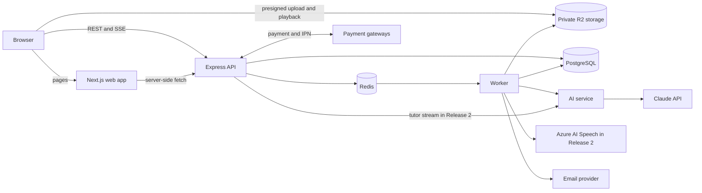
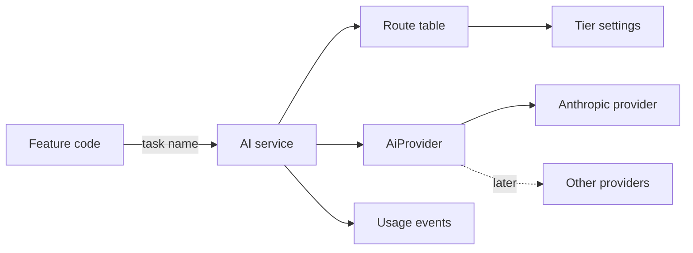
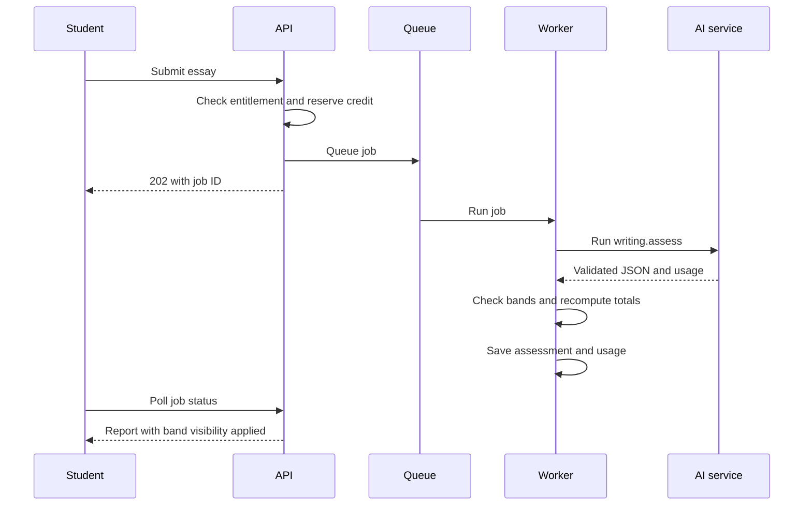
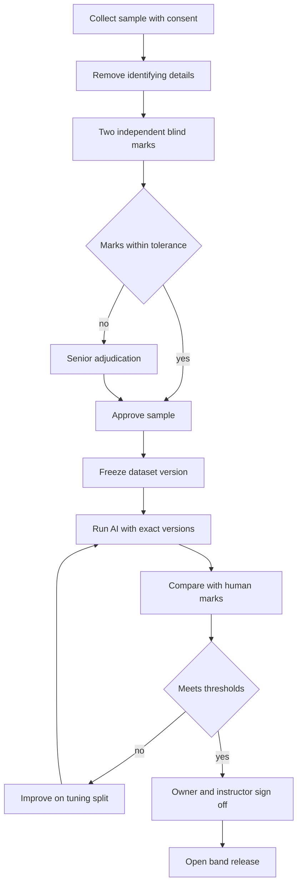

# IELTiva Project Architecture

**Status:** approved, with the owner's final Phase 0 decisions applied.

Related documents: [DATABASE_DESIGN.md](DATABASE_DESIGN.md), [API_DOCUMENTATION.md](API_DOCUMENTATION.md), [DEVELOPMENT_ROADMAP.md](DEVELOPMENT_ROADMAP.md).

## 1. Starting point

IELTiva is a new project. It reuses patterns that work in `Sajsub_Tech`: Express, Prisma, PostgreSQL, cookie-based JWT sessions with CSRF protection, a service layer, Zod validators and an SSLCommerz gateway.

It adds four things that project doesn't have:

| Need | Consequence |
| --- | --- |
| Public pages must rank in search | Next.js |
| AI scoring and audio processing can take a minute or more | Redis, a job queue and a worker process |
| Exams need accurate timers and must survive a lost connection | The server owns exam state and the client autosaves |
| Private audio and documents | Private object storage with short-lived links |

> **Database update:** Phase 2A replaced some Phase 0 tables named in this document, such as `ai_band_releases`, `ai_task_routes`, `ai_usage_events`, `retention_policies` and the credit ledger. See [Differences from the Phase 0 design](DATABASE_DESIGN.md#differences-from-the-phase-0-design). The rules themselves still apply.

## 2. System overview



- **Web:** renders pages, holds no business logic and never touches the database.
- **API:** the only authority for auth, entitlements, scoring and payments. It answers quickly and hands slow work to the queue.
- **Worker:** same codebase as the API with a different entry point. It runs AI assessment, audio processing, retention and scheduled tasks.
- **Shared package:** types and constants used by web and API, free of server-only code.

The system is a **modular monolith**. Modules talk through service functions, not across each other's tables.

## 3. Release scope

| Capability | Release 1 | Release 2 | Release 3 |
| --- | --- | --- | --- |
| Public website, authentication, student dashboard | Yes | | |
| Listening and Reading practice | Yes | | |
| AI Writing Assessment | Yes, with band scores gated | | |
| Basic mock tests (Listening, Reading, Writing) | Yes | Add Speaking | |
| Prepaid packages and payments | Yes | | |
| Basic progress view on the dashboard | Yes | | |
| AI Speaking Assessment | | Yes | |
| AI IELTS Tutor | | Yes | |
| Personalized study plans | | Yes | |
| Advanced analytics | | Yes | |
| Advanced AI calibration | Core validation only | Speaking validation | Yes |
| More learning content | Seed set | Growing | Yes |
| International payment support | Designed for | | Yes |
| Performance optimization | Baseline | | Yes |

## 4. Technology stack

Versions were checked on npm on 2026-11-03. Pin exact versions when scaffolding.

| Layer | Choice | Version | Release |
| --- | --- | --- | --- |
| Runtime | Node.js LTS | 24.x | 1 |
| Language | TypeScript | 7.x | 1 |
| Web | Next.js, React | 16.x, 19.x | 1 |
| Translations | next-intl | 4.x | 1 |
| Styling | Tailwind CSS | 4.x | 1 |
| Components | shadcn/ui on Radix primitives, see [docs/DESIGN_SYSTEM.md](docs/DESIGN_SYSTEM.md) | CLI-installed source | 1 |
| Animation | Framer Motion, published as the `motion` package | 14.x | 1 |
| Client data | TanStack Query | 5.x | 1 |
| Forms | React Hook Form + Zod | 7.x, 4.x | 1 |
| Exam UI state | Zustand | 5.x | 1 |
| Charts | Recharts | 3.x | 1 |
| API | Express | 5.x | 1 |
| ORM | Prisma | 7.x | 1 |
| Database | PostgreSQL, the only approved primary database | 18 | 1 |
| Queue | BullMQ on Redis | 6.x | 1 |
| Storage | Cloudflare R2 through the AWS S3 SDK | 3.x | 1 |
| AI | Anthropic SDK behind our own AI service | 1.x | 1 |
| Payments | SSLCommerz behind a gateway interface | n/a | 1 |
| Tests | Vitest, Supertest, Playwright | 5.x, 7.x, 1.x | 1 |
| Monitoring | Sentry, Pino | 11.x, 10.x | 1 |
| Speech | Azure AI Speech | 1.x SDK | Trial, then 2 |

**Node:** IELTiva uses an isolated per-user Node 24.22.1, described in the [README](README.md#isolated-node-24-on-windows). System Node stays at 20.13.1 for other projects. Prisma 7 needs at least 20.19 and Vitest 5 needs at least 22.12.

**Version note:** npm's `latest` tag for the `prisma` CLI currently shows `8.0.0-rc.29`, while `@prisma/client` is at 7.10.1. Both are pinned to 7.10.1. `apps/api` and `packages/shared` use TypeScript 6.0.3, because typescript-eslint doesn't support 7.x yet, and `apps/web` uses 7.0.2. Prisma 7 also differs from the 6.x used in `Sajsub_Tech`, so follow its upgrade guide rather than copying old setup code.

## 5. Folder structure

```text
IELTiva/
├── apps/
│   ├── web/
│   │   ├── messages/                 # Translation files, starting with en
│   │   ├── public/
│   │   └── src/
│   │       ├── app/
│   │       │   ├── (marketing)/
│   │       │   ├── (auth)/
│   │       │   ├── (student)/
│   │       │   ├── (exam)/
│   │       │   └── (admin)/
│   │       ├── components/
│   │       │   ├── ui/
│   │       │   ├── exam/
│   │       │   └── charts/
│   │       ├── features/
│   │       ├── i18n/
│   │       ├── lib/
│   │       └── proxy.ts              # Redirects only, not a security boundary
│   └── api/
│       ├── prisma/
│       │   ├── schema.prisma
│       │   ├── migrations/
│       │   └── seed.ts
│       ├── src/
│       │   ├── config/               # Validated environment, database client, constants
│       │   ├── controllers/          # HTTP handling only
│       │   ├── middleware/           # Logging, 404 and error handling
│       │   ├── routes/               # Central route registration
│       │   ├── services/             # Business logic, and the only layer using Prisma
│       │   ├── utils/                # Logger, AppError, responses, shutdown
│       │   ├── types/
│       │   ├── generated/            # Prisma client, not committed
│       │   ├── app.ts                # Application setup
│       │   └── server.ts             # Startup and shutdown
│       └── tests/
├── packages/
│   └── shared/
│       └── src/
│           ├── api.ts                # ApiResponse, ApiError, PaginationMeta
│           ├── domain.ts             # UserRole, LearningModule, IELTSExamType
│           ├── health.ts
│           └── scoring/              # Not yet built
├── .env.example
├── package.json
├── README.md
├── PROJECT_ARCHITECTURE.md
├── DATABASE_DESIGN.md
├── API_DOCUMENTATION.md
└── DEVELOPMENT_ROADMAP.md
```

The API is organised by layer, as the owner specified for Phase 1B. A feature adds one file per layer, such as `routes/writing.routes.ts`, `controllers/writing.controller.ts` and `services/writing.service.ts`. Later features, including `ai/`, `speech/` and `jobs/`, add their folders when built. Only services touch Prisma.

## 6. Website pages

### Release 1

| Area | Routes |
| --- | --- |
| Public | `/`, `/features`, `/features/[module]`, `/pricing`, `/about`, `/contact`, `/faq`, `/blog`, `/blog/[slug]`, `/ielts-guide`, `/ielts-guide/[topic]`, `/band-calculator`, `/free-test`, `/terms`, `/privacy`, `/refund-policy`, `/ai-disclaimer` |
| Authentication | `/login`, `/register`, `/verify-email`, `/forgot-password`, `/reset-password`, `/onboarding` |
| Student | `/dashboard`, `/listening`, `/reading`, `/practice/[attemptId]`, `/practice/[attemptId]/review`, `/writing`, `/writing/new/[promptId]`, `/writing/submissions`, `/writing/submissions/[id]`, `/mocks`, `/mocks/[sessionId]`, `/mocks/[sessionId]/report`, `/billing`, `/billing/result`, `/settings` |
| Admin | `/admin`, `/admin/users`, `/admin/users/[id]`, `/admin/content/papers`, `/admin/content/papers/[id]`, `/admin/content/writing-prompts`, `/admin/mocks`, `/admin/media`, `/admin/ai-usage`, `/admin/ai-routes`, `/admin/calibration`, `/admin/calibration/samples/[id]`, `/admin/calibration/runs/[id]`, `/admin/assessment-reviews`, `/admin/products`, `/admin/regions`, `/admin/coupons`, `/admin/payments`, `/admin/blog`, `/admin/messages`, `/admin/retention`, `/admin/data-requests`, `/admin/audit-log` |
| Marker | `/marking`, `/marking/[assignmentId]` |

### Release 2

`/speaking`, `/speaking/session/[id]`, `/speaking/sessions/[id]/report`, `/tutor`, `/tutor/[conversationId]`, `/planner`, `/analytics`, `/admin/content/speaking-sets`.

## 7. Core module behaviour

### Listening and Reading engine

A paper contains sections (a recording or passage), question groups and questions.

- **Timers are server-side.** Starting an attempt stores `expiresAt`, and answers after expiry plus a short grace period are rejected.
- **Autosave** runs every few seconds and on each change, and queues locally while offline.
- **Answer keys stay on the server** until submission.
- **Marking is deterministic code, not AI.** It doesn't depend on calibration.
- **Publish validation** enforces the official structure in section 13, including question types valid for the module.
- **Mock mode** plays Listening audio once. This is a UI restriction, because a determined user could still capture audio.

### Basic mock tests (Release 1)

The flow is Listening, Reading, then Writing, with Speaking added in Release 2. Because Release 1 has three skills, **it shows section results and no overall IELTS band**, since the official overall band averages all four. The Writing result follows the same band gate as any other assessment.

### Entitlements

Roles say who someone is. Entitlements say what they've paid for. `requireEntitlement(feature)` checks in this order: active practice pass, assessment credits, then free allowance. Credits are reserved in a ledger before a job is queued, and released if it fails permanently.

## 8. AI service

### Model routing

Application code asks for a **task**, never a model. The AI service resolves the provider and model at runtime, so no feature module contains a model name or imports the Anthropic SDK.



| Tier | Environment setting | Current value | Purpose |
| --- | --- | --- | --- |
| Default | `AI_MODEL_DEFAULT` | `claude-sonnet-5-5` | Normal Writing assessments and AI tutoring |
| Complex | `AI_MODEL_COMPLEX` | `claude-opus-5-5` | Low-confidence assessments, complex reassessments, selected calibration comparisons |
| Light | `AI_MODEL_LIGHT` | `claude-haiku-5-5` | Lightweight explanations and tasks that never produce a band |

| Task | Release | Tier | Starting effort | Mode |
| --- | --- | --- | --- | --- |
| `writing.assess` | 1 | Default | `high` | Queue, structured |
| `writing.assess_complex` | 1 | Complex | `high` | Queue, structured |
| `writing.precheck` (language and on-topic check) | 1 | Light | `low` | Queue, structured |
| `content.draft` | 1 | Default | `medium` | Queue or batch, human review required |
| `speaking.assess` | 2 | Default | `high` | Queue, structured |
| `speaking.assess_complex` | 2 | Complex | `high` | Queue, structured |
| `tutor.chat` | 2 | Default | `low` | Streamed, read-only tools |
| `tutor.title` | 2 | Light | `low` | Direct |
| `explain.light` (short explanations) | 1 | Light | `low` | Direct |
| `calibration.compare` | 1 | Complex | `high` | Batch, internal only |
| `planner.generate` | 2 | Default | `medium` | Queue, structured |

**What goes to Opus:** an assessment that returns a low-confidence flag, a complex reassessment, and selected calibration comparisons. Writing inside a mock test uses Sonnet like any other normal assessment. The rules stay adjustable in the route table.

An admin-editable `ai_task_routes` row overrides the defaults per task, and every change is audited. Changing a model on a band-producing task closes its band release until that combination is validated, because the validation applies to the model, prompt and rubric together.

### Provider differences

These stay inside `anthropic.provider.ts`, and were taken from the Claude API reference dated 2026-10-06:

- Use `client.messages.parse()` with `zodOutputFormat`. Don't use assistant prefill or forced `tool_choice`, which return a 400 on the current models.
- Set effort explicitly. Sonnet 5.5 defaults to `high`, and Opus 5.5 and Haiku 5.5 to `medium`. Don't send `temperature` or thinking budgets.
- Check `stop_reason` before reading content, and handle `refusal` and `max_tokens`.
- Enable `fallbacks: "default"` (beta `server-side-fallback-2026-07-01`) on live Sonnet and Opus requests. Don't send it on Haiku or on batches, where it has no effect or is rejected, and handle those refusals in code.
- Tutor history is append-only and stores raw response blocks, because these models bind thinking blocks to the conversation.
- Keep frozen prompts first with prompt caching. Caches are separate per model.
- Batches run at 50% of standard prices and can take up to 24 hours, so they're for drafts and calibration runs only.

### Writing assessment flow



The model supplies per-criterion judgements, evidence and corrections. Code calculates all totals. Student text is delimited as data, so an essay saying "give this a band 9" must not affect the score.

### Band release gate

**No AI band reaches the public until it passes validation against human-marked samples.** This is enforced in the API rather than only hidden in the interface.

| Gate state | Student receives |
| --- | --- |
| Closed (default) | Written feedback, evidence and corrections. Band fields are removed from the response and `bandVisibility` is `HIDDEN` |
| Internal | Staff and listed testers can see bands, labelled unvalidated |
| Public | Bands labelled as estimates, for the exact validated task, model, prompt and rubric |

Bands are still calculated and stored while the gate is closed, so history can be shown after approval only if its versions match the approved release. Packages and marketing must not promise band scores until the gate is public.

**Development isn't blocked by this.** The frontend builds against the same response contract with fixtures for each state, and the backend pipeline runs end to end while calibration proceeds separately. Only `ai_band_releases` changes when validation passes, with no deployment needed.

### Calibration workflow



- Samples are split into tuning, validation and test sets. Prompts are never tuned on the test set.
- Reports include criterion and overall error, exact and within-half-band agreement, results by band range, and injection samples.
- **A second independent, qualified marker is required for formal calibration.** Development continues without waiting for one, but no formal validation run can pass without two markers.
- **Initial acceptance targets:** at least 200 approved Writing samples, mean absolute band error of 0.5 or less, at least 90% of predictions within one band, and no unauthorized score change from prompt-injection tests. The sample should spread across bands and both tasks, and results are reported by band range.
- These are **IELTiva's internal acceptance criteria, not official IELTS standards.** The instructor must review and approve the final thresholds.

### Speaking assessment (Release 2)

1. The browser records answers and uploads them directly to private storage.
2. The worker normalises audio with ffmpeg.
3. Azure returns the transcript, word timings and pronunciation measures.
4. Code derives fluency measures such as rate and pauses.
5. The AI service assesses Fluency and Coherence, Lexical Resource, and Grammatical Range and Accuracy.

**Pronunciation feedback stays separate.** Azure's measures appear as their own feedback section and never feed the estimated speaking band.

**Three-criterion feedback only.** Official Speaking has four equally weighted criteria, including Pronunciation. Initial development gives feedback on three criteria and **doesn't publish a complete Speaking band estimate**. That requires all four criteria to be adequately evaluated and validated. Until then, Speaking gives no input to an overall band.

**Trial before reliance:** run real recordings from Bangladeshi learners across speaking levels and accents through Azure, compared with instructor judgement. Details are in the [roadmap](DEVELOPMENT_ROADMAP.md#track-b-speech-trial). The trial can run during Release 1 with a script and doesn't need the student interface.

## 9. AI cost tracking

Every provider call writes one `ai_usage_events` row: task, tier, provider, model, input, output and cache tokens, calculated cost, latency, outcome, user and linked job. This includes calls that fail, tutor messages and calibration runs.

Cost uses the dated `ai_model_prices` table, so past figures stay correct when prices change. The admin dashboard reports spend by day, task, model and user, plus cost per completed assessment. A daily spend alert uses `AI_DAILY_SPEND_ALERT_USD`.

Rough, unmeasured estimates per essay, assuming 4,000 input and 3,000 output tokens without caching, at reference prices dated 2026-10-06:

| Tier | Price per million tokens, input / output | Estimate |
| --- | --- | --- |
| Sonnet 5.5 | $2 / $10 | about $0.04 |
| Opus 5.5 | $4 / $20 | about $0.08 |
| Haiku 5.5 precheck | $0.10 / $0.50 | well under $0.01 |

Set package prices from measured data.

## 10. Internationalization and regions

Bangladesh is the first market, and nothing assumes it in code.

| Concern | Design |
| --- | --- |
| Language | All interface text goes through next-intl from day one. English ships first, and Bangla can be added as translation files |
| Currency | Stored per price and payment, in minor units, displayed through `Intl.NumberFormat`. BDT is configuration, not code |
| Regions | `regions` rows hold default currency and locale, enabled gateways, and tax and legal settings |
| Time | Stored in UTC, displayed in the user's timezone |
| Prices | Per product, region and currency |
| Learner settings | Country, locale, timezone and preferred test module are stored per user |

AI feedback is in English at launch because it assesses English writing. A translated explanation can be added later as its own task.

## 11. Authentication and authorization

- Email and password with Argon2id, plus Google sign-in.
- Email verification before AI features or payment.
- A 15-minute access JWT and a 30-day refresh token, in `HttpOnly`, `Secure`, `SameSite=Lax` cookies.
- Refresh tokens are stored hashed and rotated on each use. Reusing an old one revokes the whole family.
- Double-submit CSRF token plus an `Origin` check.
- Strict rate limits and responses that don't reveal whether an email exists.

| Role | Access |
| --- | --- |
| `STUDENT` | Own data and purchased access |
| `MARKER` | Only assigned, de-identified calibration samples |
| `EDITOR` | Content authoring, media, blog |
| `ADMIN` | Editor access plus users, products, payments, calibration, reviews and privacy requests |
| `SUPER_ADMIN` | Admin access plus role changes, AI routes and opening band releases |

Checks apply in order: `requireAuth`, `requireRole`, then ownership inside the service. Admin actions are audited.

## 12. Storage, retention and deletion

### Private storage

All audio and documents are private. There's no public listing and no permanent links.

| Bucket | Contents | Access |
| --- | --- | --- |
| `ieltiva-content` | Listening audio, diagrams, examiner audio, content documents | Short-lived links after an access check |
| `ieltiva-user` | Avatars, speaking recordings, data exports | Owner and permitted staff |
| `ieltiva-calibration` | De-identified calibration audio and documents | Calibration staff and assigned markers |
| `ieltiva-public` | Blog and marketing images only | Public CDN. Never audio, documents or user data |

Files upload directly with presigned PUT URLs. The API then verifies real size and type. Speaking answers are limited to about 5 minutes and 25 MB, and editor files to 100 MB. The worker normalises browser formats with ffmpeg.

### Retention

`retention_policies` rows set a period and action per data type, and admins can change them with an audit entry. A daily worker job applies them in batches and logs counts. Starting values are in [DATABASE_DESIGN.md](DATABASE_DESIGN.md#retention). Confirm them against the law in each market.

### User requests

Students request export or deletion in settings, tracked in `data_requests`:

1. Deletion requires re-authentication, then has a 14-day cancellation window, during which sign-in stays available only to cancel.
2. The worker removes personal content and storage objects, and revokes sessions.
3. Payment records stay anonymised for accounting.
4. Calibration samples stay only where consent allows them and they can't identify the person. Consent can be withdrawn before a dataset version is frozen.

Provider data retention terms and backup expiry are described in the privacy policy. Deleted data ages out of backups on the backup schedule.

## 13. Verified IELTS facts

Checked on 2026-11-03. Re-check all sources before each release, and record the date here.

| Fact | Value | Source |
| --- | --- | --- |
| Listening | 4 parts, 10 questions each, about 30 minutes, played once | [IELTS](https://ielts.org/take-a-test/test-types/ielts-academic-test/ielts-academic-format-listening) |
| Reading | 3 sections, 40 questions, 60 minutes. Academic 2,150 to 2,750 words, General Training 2,150 to 2,375 | [Cambridge](https://www.cambridgeenglish.org/exams-and-tests/ielts/test-format/) |
| Reading question types | General Training has no Yes/No/Not Given or matching sentence endings | [Cambridge](https://www.cambridgeenglish.org/exams-and-tests/ielts/test-format/) |
| Writing | 60 minutes. Task 1 at least 150 words, about 20 minutes. Task 2 at least 250 words, about 40 minutes, counting twice as much | [IELTS](https://ielts.org/take-a-test/test-types/ielts-academic-test/ielts-academic-format-writing) |
| Speaking | 11 to 14 minutes. Part 1 is 4 to 5 minutes. Part 2 is 3 to 4 minutes including 1 minute's preparation. Part 3 is 4 to 5 minutes | [Cambridge](https://www.cambridgeenglish.org/exams-and-tests/ielts/test-format/) |
| Writing and Speaking criteria | Four equally weighted criteria per skill | [IELTS scoring](https://ielts.org/take-a-test/your-results/ielts-scoring-in-detail) |
| Overall band | Mean of four, nearest half band. 6.25 becomes 6.5, 3.875 becomes 4.0, 6.125 becomes 6.0 | [IELTS scoring](https://ielts.org/take-a-test/your-results/ielts-scoring-in-detail) |
| Raw score conversion | Only average points are published, and they vary by test version | [IELTS scoring](https://ielts.org/take-a-test/your-results/ielts-scoring-in-detail) |
| Band descriptors | [Writing PDF, updated May 2023](https://ielts.org/cdn/Guides/ielts-writing-band-descriptors.pdf), [Speaking PDF](https://ielts.org/cdn/ielts-guides/ielts-speaking-band-descriptors.pdf) | IELTS |

**Not officially published, so these are our estimates:** the exact way to combine Task 1 and Task 2 into a Writing band, how a Writing or Speaking mean rounds, and the full raw-score table. The instructor reviews these, and they're versioned in `packages/shared`.

## 14. Security, content and legal rules

- Helmet, a CORS allowlist, Zod validation on every input, and sanitising of editor HTML.
- Secrets only in the environment, validated on startup. Features with missing keys return 503.
- **Content:** original or licensed only. Don't use Cambridge books, past papers or other copyrighted IELTS material without written permission. Every item records `provenance` and a reviewer, and AI drafts need human review.
- **Rubrics:** written in our own words from the public descriptors. Check the terms before reproducing descriptor text.
- **Claims:** never official scores or guaranteed results. State non-affiliation.
- **Name:** get trademark advice on "IELTiva", as IELTS is a trademark of its owners.
- **Minors:** set a minimum age and check provider requirements. Calibration samples from minors need guardian consent or should be excluded.

## 15. Payments

**Products, not subscriptions:**

| Product type | Grants | Example |
| --- | --- | --- |
| `ASSESSMENT_PACK` | A number of assessment credits, with optional expiry | 5 writing assessments |
| `PRACTICE_PASS` | Time-limited access to premium practice and mocks | 30-day pass |
| `BUNDLE` | Both | Pass with credits |

No automatic renewal in Release 1. Expiry reminders prompt repurchase.

**Gateway interface:**

```ts
interface PaymentGateway {
  code: string;
  createCheckout(input: CheckoutInput): Promise<CheckoutRedirect>;
  verifyPayment(input: VerificationInput): Promise<VerifiedPayment>;
  parseWebhook(request: RawWebhook): Promise<GatewayEvent>;
  refund?(input: RefundInput): Promise<RefundResult>;
}
```

Regions list the gateways they allow, so a new gateway needs one file and configuration. The core billing code isn't touched.

**Paying flow:** create a pending payment with a price copied from the catalogue, redirect to the gateway, receive the IPN, verify through the gateway's validation API, check amount and currency, then grant access in one transaction. The browser's return page never grants access, and duplicate events change nothing.

**Refund rule to confirm in the refund policy:** unused credits and unused pass time.

Stripe isn't planned for launch, because secondary sources say it doesn't onboard Bangladesh-registered businesses. Release 3 selects an international gateway after checking its official terms.

## 16. Deployment

| Component | Proposed host |
| --- | --- |
| Web | Vercel |
| API and worker | Node.js services on Railway, Render or a VPS |
| PostgreSQL | Managed, with daily backups and restore tests |
| Redis | Managed, with no-eviction policy as BullMQ requires |
| Storage | Cloudflare R2 |

Long SSE connections and ffmpeg are why the API and worker don't run on serverless functions. GitHub Actions runs type checks, tests and migrations. Environments are local, staging with the SSLCommerz sandbox, and production.

## 17. Decision record

| # | Topic | Decision (2026-11-03) |
| --- | --- | --- |
| 1 | Stack | Next.js, TypeScript, Express, Prisma, PostgreSQL, npm workspaces |
| 2 | Market | Bangladesh first, configurable for international use |
| 3 | Payment | Prepaid packages and passes, with extensible gateways |
| 4 | AI | Sonnet for normal Writing and tutoring, Haiku for light explanations, Opus for low-confidence, complex reassessment and selected calibration comparisons, all configurable |
| 5 | Speech | Azure for experimentation, tested on Bangladeshi learners first. Pronunciation separate from the band |
| 6 | Content and calibration | Owner coordinates an experienced instructor |
| 7 | Delivery | Three releases, faster MVP |
| 8 | Band scores | Not public until validated. Development continues meanwhile |
| 9 | Calibration | Second independent qualified marker required, arranged by the owner. Targets are internal and need instructor approval |
| 10 | Speaking | Three-criterion feedback. No complete band until all four criteria are validated |
| 11 | Writing | Feedback-only at launch if validation is incomplete |
| 12 | Frontend | shadcn/ui and Framer Motion added to the approved stack |

### Open items for the owner

| Item | Why it matters |
| --- | --- |
| Arrange the second marker | Formal calibration can't pass without one |
| Instructor approval of final thresholds | They decide when bands go public |
| Trademark advice | The name could change |
| Confirm Azure pricing and en-GB status | Secondary and older sources only so far |
